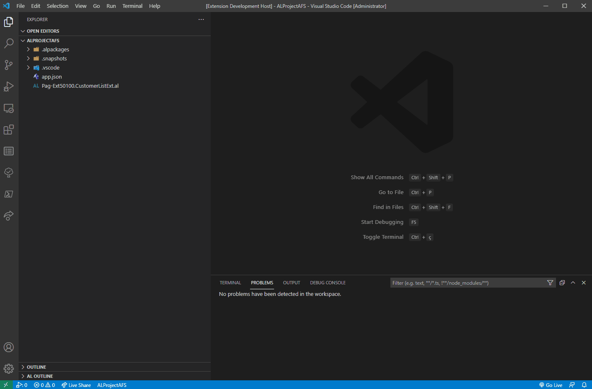
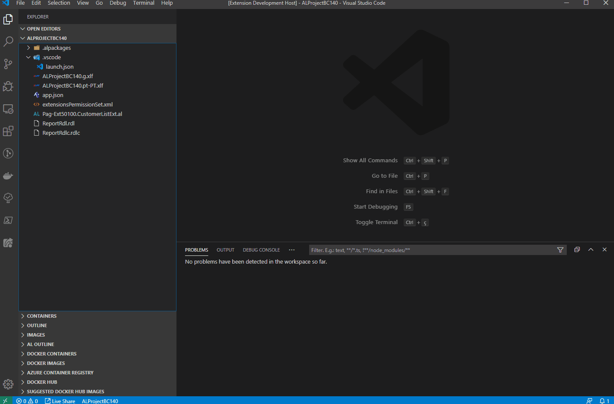
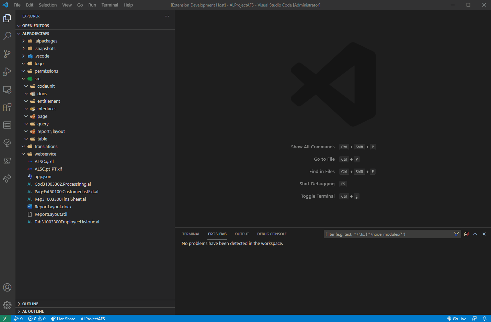
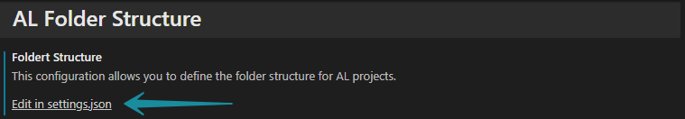
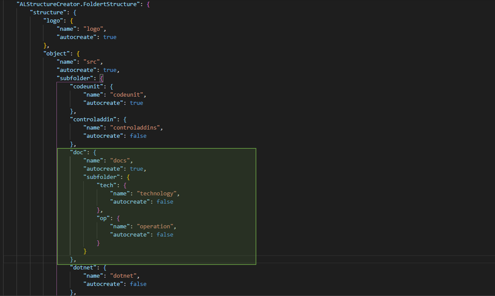

#

  
  <h1 align="center">AL Structure Creator</h1>

  
  
  
  
  
  

## Features

This extension allows you to create the folder structure for AL projects and help you organize the application files.
You can also customize the standard structure or use other names to create a folder structure that best suits you.

---

## Requirements

* `Dynamics 365 Business Central`.
* `Visual Studio Code` 1.95 or later.
* `AL Language Extension for VSCode`.

---

## Extension Settings

This extension contributes the following settings:

* `ALStructureCreator.FolderStructure`: This configuration allows you to define the folder structure for AL projects that best suits you.
* `ALStructureCreator.ObjectIdentification`: This configuration defines how to identify the objects files, by the object prefix/suffix filename or
reading the file. **Prefix**, **Suffix** or **Object** (e.g: `TableEmployeeMgt.al`, `EmployeeMgtTable.al`,
or a file that starts with `table 50010 "Employee Mgt."`).
* `ALStructureCreator.ObjectIdent.<ObjectType>`: This configuration defines how to identify a specific object file by its prefix/suffix name.
* `ALStructureCreator.ObjectIdent.MaxReadLine`: Set this configuration to limit the amount of lines to read when identifying the objet type for
the **Reorganize Files** command.

The **ObjectIdent**/**ObjectIdentification** settings are used by the **Reorganize Files** command.
When more than one identifier matches a file name (for example `Page` and `PageExt` in `CustomerPageExt.al`), the longest one wins.

---

## Customization

You can add your own folders to the default structure. VS Code merges your `FolderStructure` value with the default one,
so you only need to write the folders you want to add or change. Keep the folder keys in lowercase (`pageext`, not `pageExt`).
<table>
  <tr>
    <th>Property</th>
    <th>Example</th>
    <th>Description</th>
  </tr>
  <tr>
    <td>Folder Key</td>
    <td>doc</td>
    <td>Key name of the folder</td>
  </tr>
  <tr>
    <td>Name</td>
    <td>--docs</td>
    <td>Name of the folder when created</td>
  </tr>
  <tr>
    <td>Auto-Create</td>
    <td>--true</td>
    <td>To automatically create the folder when call "Create All Folder Structure" command</td>
  </tr>
  <tr>
    <td>Create-Cust</td>
    <td>--createcust</td>
    <td>To also create a "&lt;name&gt;cust" folder for customizations (e.g. pagecust)</td>
  </tr>
  <tr>
    <td>Subfolder</td>
    <td>--subfolder</td>
    <td>To add subfolders inside the main folder</td>
  </tr>
</table>

---

## Extension Commands

This extension contributes the following commands:

* `ES: Create All Folder Structure`: This command create all application folder structure for AL projects.
* `ES: Create Folder Structure`: This command create a defined application folder for AL projects. Type one of the folder keys or shortcuts
below, or the key of a folder you added to `FolderStructure`.

<table>
  <tr>
    <th>Folder Code/Structure</th>
    <th>Folder Name</th>
    <th>Shortcut/Parameter</th>
  </tr>
  <tr>
    <td>logo</td>
    <td>logo</td>
    <td>logo</td>
  </tr>
  <tr>
    <td>object</td>
    <td>src</td>
    <td>src/obj/object</td>
  </tr>
  <tr>
    <td>--codeunit</td>
    <td>codeunit</td>
    <td>cod/codeunit</td>
  </tr>
  <tr>
    <td>--controladdin</td>
    <td>controladdin</td>
    <td>ctrl/controladdin</td>
  </tr>
  <tr>
    <td>--dotnet</td>
    <td>dotnet</td>
    <td>dnet/dotnet</td>
  </tr>
  <tr>
    <td>--entitlement</td>
    <td>entitlement</td>
    <td>ent/entitlement</td>
  </tr>
  <tr>
    <td>--enum</td>
    <td>enum</td>
    <td>enu/enum</td>
  </tr>
  <tr>
    <td>--enumext</td>
    <td>enumext</td>
    <td>enuext/enumext</td>
  </tr>
  <tr>
    <td>--interface</td>
    <td>interface</td>
    <td>int/interface</td>
  </tr>
  <tr>
    <td>--page</td>
    <td>page</td>
    <td>pag/page</td>
  </tr>
  <tr>
    <td>--pageext</td>
    <td>pageext</td>
    <td>pagext/pageext</td>
  </tr>
  <tr>
    <td>--permissionset</td>
    <td>permissionset</td>
    <td>pers/permissionset</td>
  </tr>
  <tr>
    <td>--permissionsetext</td>
    <td>permissionsetext</td>
    <td>persext/permissionsetext</td>
  </tr>
  <tr>
    <td>--profile</td>
    <td>profile</td>
    <td>pro/profile</td>
  </tr>
  <tr>
    <td>--query</td>
    <td>query</td>
    <td>que/query</td>
  </tr>
  <tr>
    <td>--report</td>
    <td>report</td>
    <td>rep/report</td>
  </tr>
  <tr>
    <td>----layout</td>
    <td>layout</td>
    <td>lay/layout</td>
  </tr>
  <tr>
    <td>--reportext</td>
    <td>reportext</td>
    <td>repext/reportext</td>
  </tr>
  <tr>
    <td>--table</td>
    <td>table</td>
    <td>tab/table</td>
  </tr>
  <tr>
    <td>--tableext</td>
    <td>tableext</td>
    <td>tabext/tableext</td>
  </tr>
  <tr>
    <td>--xmlport</td>
    <td>xmlport</td>
    <td>xml/xmlport</td>
  </tr>
  <tr>
    <td>translation</td>
    <td>translations</td>
    <td>tran/translation</td>
  </tr>
  <tr>
    <td>webservice</td>
    <td>webservice</td>
    <td>web/webservice</td>
  </tr>
</table>

* `ES: Reorganize Files`: This command moves the application files from the project root to the corresponding folder: AL objects by their type,
report layouts (`.rdl`, `.rdlc`, `.docx`, `.xlsx`) to `layout`, images to `logo` and `.xlf` files to `translation`. Files that already exist in the
target folder are skipped.

---

## Keyboard Shortcuts

| Shortcut | Command |
| --- | --- |
| `Alt+E` `Alt+C` | ES: Create All Folder Structure |
| `Alt+E` `Alt+R` | ES: Reorganize Files |

The shortcuts only work when a folder or workspace is open.

---

## Release Notes

Release **2.0.0**. See the [CHANGELOG](CHANGELOG.md) for the full list of changes.

* Folders for extension objects (`enumext`, `pageext`, `permissionsetext`, `reportext`, `tableext`) are now created and used correctly.
* **Reorganize Files** now recognises every AL object type, including `reportextension`, and no longer stops at the first error.
* Working keyboard shortcuts and a validated `FolderStructure` setting.
* **Breaking:** the `pageExt` folder key is now `pageext`. If you customised it, rename the key in your settings.

---

## Authors

* [**EdySpider**](https://github.com/edyspider/)
* [**Eder Leal da Silva**](https://github.com/ederlealsilva/)

---

## License

* **[MIT license](https://github.com/edyspider/ALStructureCreator/blob/master/LICENSE)**
* Copyright 2020 &copy; <a href="https://github.com/edyspider" target="_blank">EdySpider</a>.
